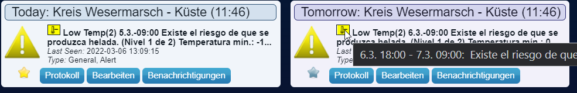

# MeteoAlarmEU-Atom

[](CHANGELOG.md)
[](https://github.com/janreimen/Domoticz-MeteoAlarmEU-Atom/actions/workflows/tests.yml)
[](LICENSE)

Show official weather warnings from [meteoalarm.org](http://www.meteoalarm.org/)
as devices in your [Domoticz](https://www.domoticz.com/) home automation
install.



*(Screenshot inherited from the upstream project: it shows the device
layout, not this fork's exact texts. In particular the publish time is no
longer part of the device name, see below.)*

> **New here?** For installation steps, see [`DEPLOY.md`](DEPLOY.md).
> For the version history, see [`CHANGELOG.md`](CHANGELOG.md).
> For what is planned, see [`ROADMAP.md`](ROADMAP.md).
> To report a problem or help out, see [Community](#community) below.
> This file covers what the plugin does, its settings, and how it works.

---

## What this is

A Domoticz virtual hardware plugin that turns
[meteoalarm.org](http://www.meteoalarm.org/)'s official European weather
warnings into Domoticz devices you can dashboard, automate on, or get
notified from — no manual checking of a weather site required.

Since this is a European meteorological alerting network, it only
covers Europe — check [meteoalarm.org](https://meteoalarm.org) to
confirm your country participates.

> **Note on naming:** meteoalarm.org sunset its legacy RSS feeds in
> favour of an Atom-based CAP feed (see `CHANGELOG.md` 1.6.0/1.6.3).
> This fork tracks that change and is maintained separately from the
> original [belzetrigger/domoticz-MeteoAlarmEU](https://github.com/belzetrigger/domoticz-MeteoAlarmEU),
> which itself is a fork of [ycahome/MeteoAlarmEU](https://github.com/ycahome/MeteoAlarmEU).
> Licensed GPL-3.0, same as upstream — see [`LICENSE`](LICENSE).

## Devices it creates

| Device | Purpose |
| --- | --- |
| **Today (\<code\>)** / **Tomorrow (\<code\>)** | One Alert-device pair per configured region, e.g. `Today (LU002)`. The first region keeps Units 1/2, further regions use 5/6, 7/8, … |
| **Plugin Status** | The health of the plugin itself, not the weather — see *Plugin Status colours* below. Wire a Domoticz notification off this instead of parsing alert text |
| **Last Successful Update** | Timestamp of the last clean fetch, so a silently stuck feed is visible in the UI, not just in logs |

Device **names** are set once, when a device is created. The plugin never
renames a device on update, so dzVents/Blockly scripts that refer to a
device by name keep working and a name you chose in the GUI is kept. (A
one-time rename at start-up only touches names the plugin generated itself,
such as the old `Today` or `Today: Luxembourg (14:05)`; a name of the form
`Today (...)` counts as plugin-generated.)

The device **text** shows what the warning is, and when it was published:
`Wind (4) Area 11:00-18:00 [12:00]` — the last part is the publish time of
the newest message for that day (`[02.11. 12:00]` if it was not published
today).

### Warning levels

The level is a number from 0 to 4. It is the number in brackets in the device
text (`Wind (3)`), the value you test in a script, and the colour of the device.

| Level | Colour | Meaning |
| --- | --- | --- |
| 0 | Grey | No data: a new device before its first fetch, or the feed has been unreachable for three poll intervals |
| 1 | Green | No special awareness required |
| 2 | Yellow | The weather is potentially dangerous |
| 3 | Orange | The weather is dangerous |
| 4 | Red | The weather is very dangerous |

The level comes from the colour word in the title of the warning entry. If the
title has none, it comes from the CAP severity: `Minor` is 2, `Moderate` is 3,
`Severe` and `Extreme` are 4, and anything else is 2. A device shows the highest
level of all warnings active for its day. The level is a plain number on
purpose, so that scripts keep working; spelling it out in the text as well is
on the roadmap.

### Plugin Status colours

| Colour | Meaning |
| --- | --- |
| Grey | `Starting` — right after a start, until the first fetch has finished |
| Green | `OK` — the last fetch worked |
| Orange | `Retrying (attempt n): …` — the last fetch failed; Today/Tomorrow still show the last good data |
| Red | `FAILING since HH:MM: …` (no good fetch for three poll intervals; Today/Tomorrow have gone grey) or `CONFIG ERROR: …` (nothing is polled until the settings are fixed) |

## Settings

| Field | What it does |
| --- | --- |
| **RSSFeed** | Your country's Atom feed URL from [feeds.meteoalarm.org](https://feeds.meteoalarm.org/) — must be a `...legacy-atom-<country>` URL. Legacy RSS URLs are sunset and no longer work. |
| **RSSCode(s)** | One or more `EMMA_ID` region codes, separated by commas (e.g. `LU002, LU001`). Get them from meteoalarm.org's "geocodes json" download, or from an old-style RSS filename like `FI001.rss` → `FI001`. The first code keeps Units 1/2. All codes must belong to the **same** country/feed as RSSFeed — one fetch per heartbeat is shared across all of them. For a different country, add the hardware a second time. A code that does not look like an `EMMA_ID` (two letters, then digits), or whose country prefix does not fit the feed, is only warned about in the log. |
| **Update every x minutes** | Minutes between polls. Default **30** for newly added hardware (existing hardware keeps its stored value); 5–1440 is accepted, an empty or invalid value falls back to 30. |
| **Debug** | Verbose logging — includes a raw-feed preview on fetch/parse failure and feedparser's own malformed-feed warnings. Default off. |
| **Details and Language for Status** | `NO_DETAIL` (compact), `Details using domoticz lang` (auto-detects from Domoticz's own language setting), or an explicit language: English, German, Swedish, French, Spanish, Finnish, or Luxembourgish. Default: Luxembourgish. |
| **Show Alarm Icons** | Controls the plugin's own bundled severity+type icon set, since the feed itself no longer provides icons. `NO_ICON` (default) uses Domoticz's default Alert icon. |

## How it works

The feed is parsed directly from its structured CAP fields (verified by
fetching the live feed and inspecting it — the previous HTML-table-based
format the feed used to serve is gone). For each configured region:

- **Matching** — the region code is matched exactly against the entry's
  `geocode=EMMA_ID:...` link (not by substring), so e.g. `LU00` won't
  falsely match `LU001`.
- **Filtering** — only `cap:status: Actual` entries count; `Test`,
  `Exercise`, `Draft`, and `System` CAP messages are excluded.
- **Classification** — warning type (thunderstorm/rain/wind/etc.) and
  colour level (green/yellow/orange/red) come from the entry title and
  `cap:severity`, translated via the plugin's own built-in language
  table — independent of what language the feed itself publishes in
  (currently English only).
- **Day-splitting** — `cap:onset`/`cap:expires` (real timestamps) decide
  whether a warning belongs to Today, Tomorrow, or both. A warning
  spanning multiple days appears in both, with the non-today end shown
  as a date + day-offset (e.g. `+1d`). At midnight the plugin re-splits the
  last fetched feed for the new day without a new request, so Today and
  Tomorrow are right even with a long poll interval.
- **Urgency** — `cap:urgency` of `Future`/`Past` shows as
  `[upcoming]`/`[ending]` in verbose mode.
- **Change detection** — devices only update when the rendered
  today/tomorrow text or level actually changed, not on every poll.

### When something goes wrong

A plugin problem is never shown as a weather alert:

- **A fetch fails** (timeout, HTTP error, no network, or an answer that is
  not an Atom feed): Today/Tomorrow keep their last values and Plugin
  Status turns orange. Retries back off 1, 2, 5, 10, 30 and 60 minutes —
  never longer than the poll interval — and are logged once per change
  instead of once per attempt.
- **No good fetch for three poll intervals**: Today/Tomorrow turn grey
  (`No data - feed unreachable since HH:MM`) and Plugin Status turns red, so
  an old all-clear never stays up for days. They restore themselves on the
  next good fetch. (A grey device may still show its last warning icon.)
- **A setting that cannot work** (empty or non-http(s) feed URL, no region
  code): reported once at start-up, Plugin Status turns red with
  `CONFIG ERROR: …`, nothing is polled.
- **A region code that matches no warning** looks exactly like "no warning
  today", because the feed only lists active warnings. The plugin cannot
  tell the two apart; it only warns when a code looks wrong (see
  *Settings*).
- **A restart** keeps what the devices show; only newly created devices get
  a "No Data" placeholder.

The feed fetch has a 15-second timeout so a hung connection can't block
Domoticz's whole heartbeat cycle, and multiple regions share a single
fetch per heartbeat rather than each fetching independently.

## Bugs and ToDos

The full, prioritised list is in [`ROADMAP.md`](ROADMAP.md). The ones to
know about:

1. **Icons are unverified against a live Domoticz instance.**
   `meteoalarm_icons.zip` was built against Domoticz's documented
   custom-icon conventions (flat zip, `icons.txt` at its top level) and a
   simulated test harness, but real-world behavior for plugin-bundled
   icons on Alert-type devices specifically has conflicting documentation
   even within the Domoticz community. If icons don't appear, the plugin
   still works normally (default Alert icon) — see `DEPLOY.md` →
   *Troubleshooting*.
2. Event-type detection is keyword-matching against the entry title and
   `cap:event`. Only Thunderstorm, Rain, Coastal Event, and Forest-fire
   are confirmed against real feed data; Wind, Snow/Ice, Fog, High/Low
   Temp, Avalanches, and Flood follow MeteoAlarm's documented category
   list but aren't yet confirmed against a live warning.
3. Two Luxembourgish translations (**Coastal Event**, **Avalanches**)
   are constructed rather than attested, since neither is a real
   Luxembourg weather phenomenon with existing native vocabulary — a
   native-speaker check would help.
4. Multi-region support only covers regions within the same
   country/feed. Different countries still need a separate hardware
   instance.
5. `cap:certainty` and `cap:message_type` (Alert vs Update) are fetched
   but not yet surfaced anywhere — only `cap:urgency` made it into the
   display.
6. Idea, not yet built: trigger Domoticz automations directly off
   warnings (e.g. close blinds on a wind warning, delay garden
   watering on a rain warning) — currently you'd build that yourself
   off the Today/Tomorrow device levels.

## Developing

Structure follows the pattern from
[ffes/domoticz-buienradar](https://github.com/ffes/domoticz-buienradar):

- `fakeDomoticz.py` — simulates enough of the Domoticz plugin framework
  (Devices, Images, Log/Debug/Error) to run `plugin.py`'s
  `onStart()`/`onHeartbeat()` outside Domoticz. It records every log line
  and device update so tests can assert on them (quiet by default;
  `FAKEDOMOTICZ_VERBOSE=1` prints them).
- `testMeteo.py` — unit tests for `meteo.py`: CAP-status filtering, the
  needUpdate fingerprint, multi-day span splitting, urgency tagging,
  language mappings, icon key lookup, exact-match region codes, config
  validation, the publish-time text, and the "not a feed" guard. They run on
  a **frozen clock** (today, 12:00), so they give the same result at any
  time of day.
- `testManifest.py` — lints what Domoticz reads without running any plugin
  code: the XML manifest at the top of `plugin.py` (read the way Domoticz
  reads it) and the icon zip layout.
- `testCommunity.py` — checks the community files, the issue forms and the
  Markdown documents: required files exist, forms are valid, relative links and
  anchors resolve, headings stay in order, images have alternative text, and
  version numbers agree.
- `testPlugin.py` — end-to-end tests that drive `onStart()`/`onHeartbeat()`
  with a frozen, hand-advanced clock and a scripted feed: status colours,
  outages and recovery, backoff timing, config errors, restarts, name
  migration, midnight rollover, icons.

Run everything (the same commands CI runs on Python 3.11–3.13):

```bash
pip install -r requirements.txt -r requirements-dev.txt
python3 -m unittest discover -p 'test*.py' -v
ruff check .
```

## Community

- **Found a bug, or a warning that is wrong or missing?** Use one of the
  [issue forms](https://github.com/janreimen/Domoticz-MeteoAlarmEU-Atom/issues/new/choose).
  [`DEPLOY.md`](DEPLOY.md#troubleshooting) lists the common causes first.
- **Want to change something?** Read [`CONTRIBUTING.md`](CONTRIBUTING.md); the
  pull request template has a short checklist.
- **Everyone taking part** follows the [Code of Conduct](CODE_OF_CONDUCT.md).
- **A security problem?** Do not post it publicly, see
  [`SECURITY.md`](SECURITY.md).
- **Something hard to read or use?** See the accessibility statement,
  [`ACCESSIBILITY.md`](ACCESSIBILITY.md), for what has and has not been checked
  and how to report a barrier.

## License

GPL-3.0 — see [`LICENSE`](LICENSE). Same license as the upstream
projects this is forked from.
